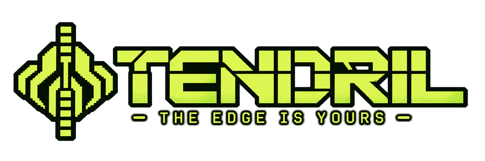
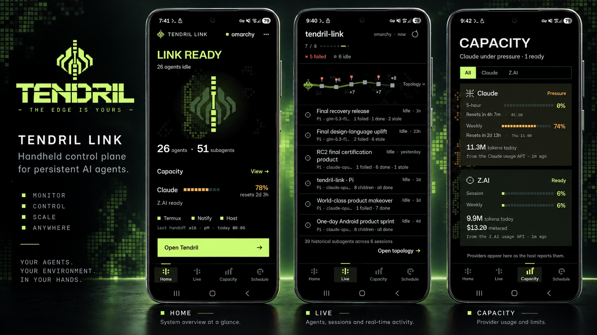
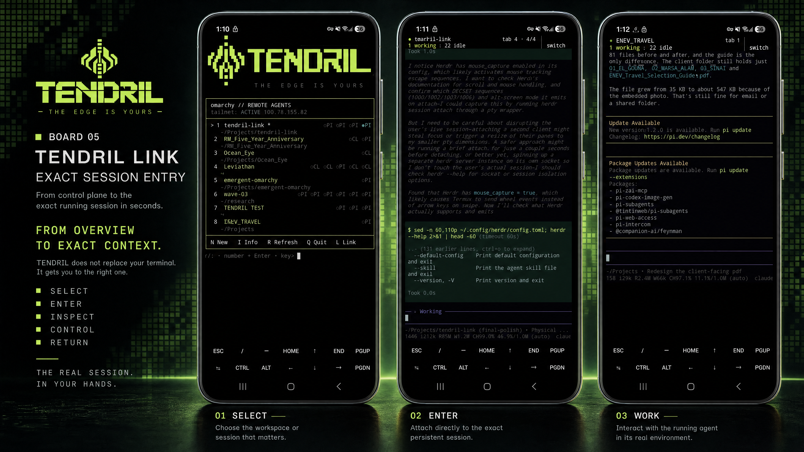
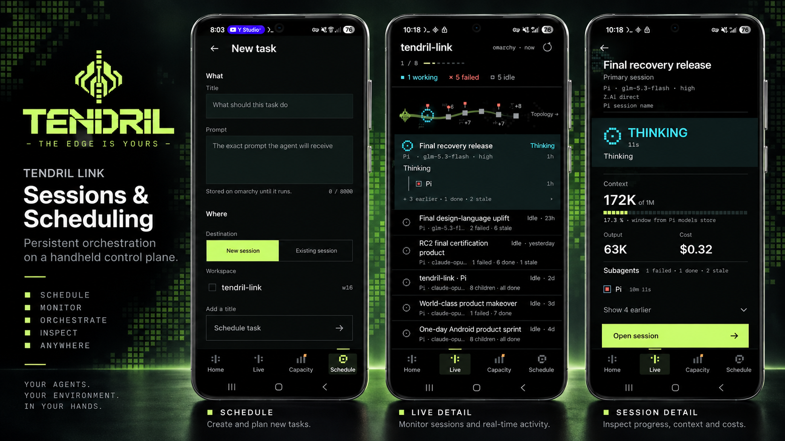
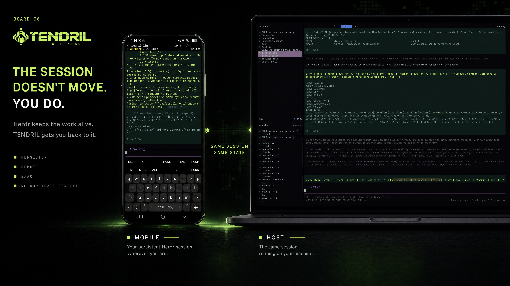
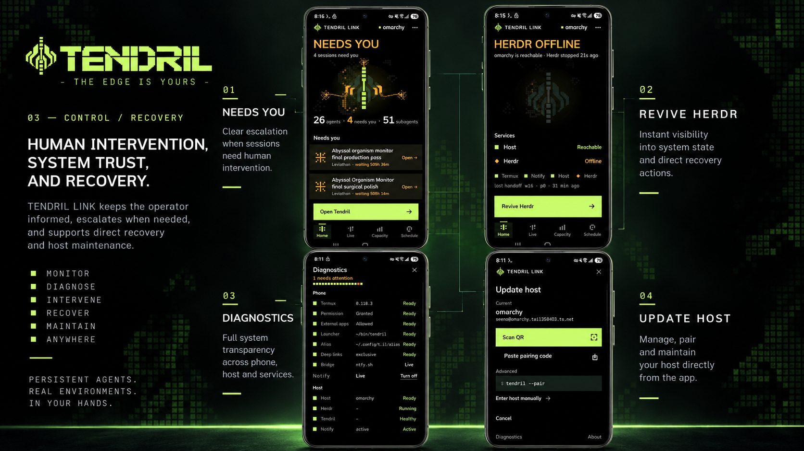
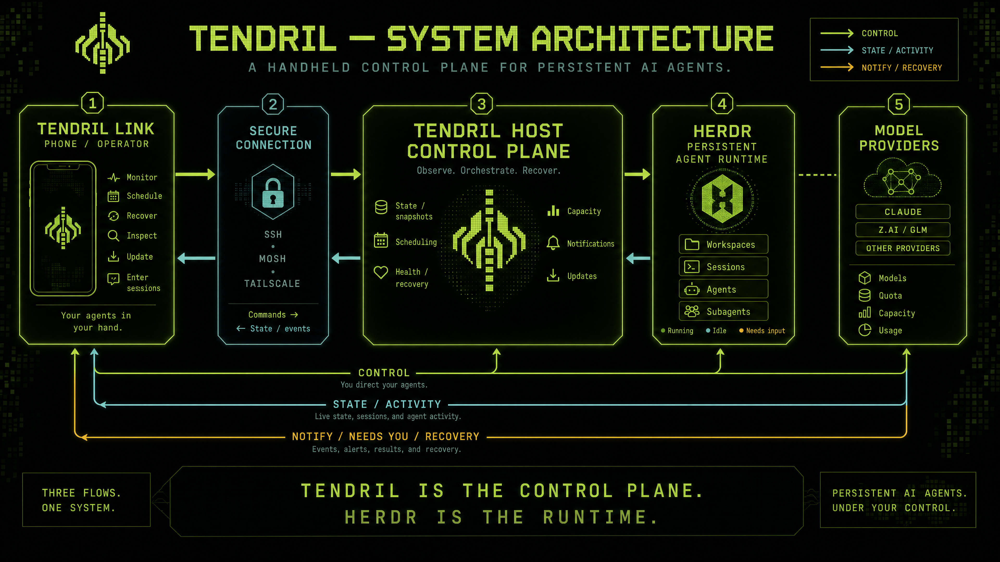
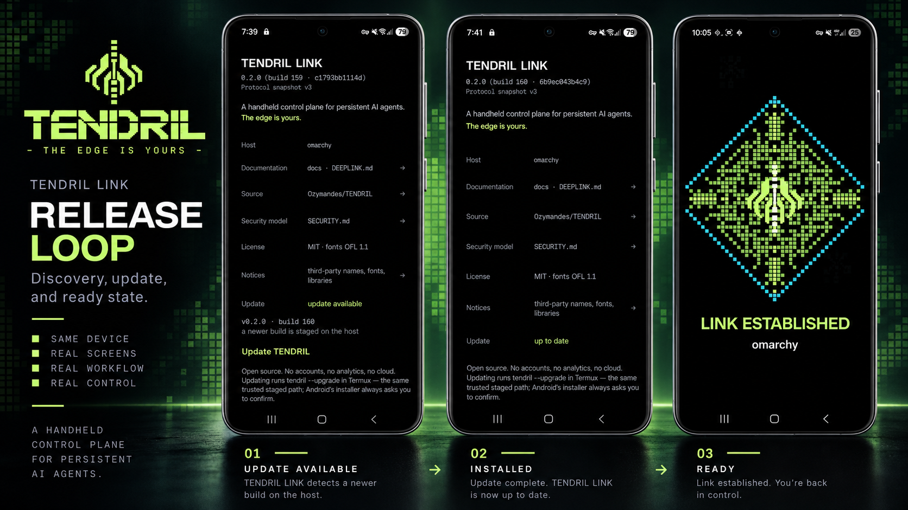

<p align="center">
  
</p>

<p align="center">
  <strong>A handheld control plane for persistent AI agents.</strong>
</p>

<p align="center">
  <a href="https://github.com/Ozymandes/TENDRIL/releases/tag/v0.2.0"></a>
  <a href="https://github.com/Ozymandes/TENDRIL/actions/workflows/ci.yml"></a>
  <a href="LICENSE"></a>
  <a href="#where-it-runs"></a>
  <a href="docs/ANDROID.md"></a>
  <a href="https://herdr.dev"></a>
</p>

---

TENDRIL turns your phone into the control surface for AI agents that live
on your own machine.

Your agents run for hours in [Herdr](https://herdr.dev) on your
workstation. From **TENDRIL Link** on your Android phone you can see which
of them are working, which are idle, which failed and which are waiting
for you — down to the subagents they spawned. You can inspect the providers
actually seen on the host — including Claude, Z.AI and OpenAI / Codex — and
see quota data where an authoritative adapter supplies it, schedule the next job,
get told when something finishes or breaks, revive Herdr when it falls
over, and drop straight into the exact terminal pane that needs you.

Underneath is the stack you already trust: Herdr keeps the agents alive,
SSH and Mosh over Tailscale carry the connection, Termux runs on the
phone. TENDRIL replaces none of it. It makes those pieces behave like one
system you can hold in one hand.

> SSH gets you into the machine. TENDRIL tells you what the machine is doing.

<p align="center">
  
</p>

Three surfaces carry most of the day:

- **HOME** is the whole system in one glance: link state, how many agents
  and subagents are alive, anything that needs you, and the most recently
  active session with a direct route to that exact dossier. Provider quota
  pressure stays on CAPACITY instead of displacing live work.
- **LIVE** is every session as it happens — working, idle, failed, needs
  input — with subagent trails, history, and a topology view.
- **CAPACITY** is provider usage and limits: session and weekly windows,
  when they reset, tokens today and metered spend.

And the control plane is only ever one tap from the terminal it watches:
pick a session in the selector and TENDRIL attaches you to that exact
Herdr pane — not a lookalike, not a transcript, the session itself.

<p align="center">
  
</p>

<p align="center">
  <em>TENDRIL does not replace your terminal.<br>It gets you to the right one.</em>
</p>

## Why TENDRIL exists

Starting an agent is the easy part. Keeping a handful of them honest over
a day is not.

Once you have several sessions on two providers, subagents spawning
subagents, a job you'd like to run the moment your quota resets, and a
runtime that occasionally decides to stop, "just SSH in and have a look"
stops being a plan. You can reach the machine from anywhere. What you
can't do from a phone keyboard is hold the whole picture in your head.

The primitives were already excellent. SSH is the transport. Mosh keeps
it alive through tunnels and lift doors. Tailscale makes the host
reachable without exposing it to the internet. Herdr keeps the agents
running after you walk away.

What was missing was the layer that knows what all of it *means*: which
session is blocked, which provider is about to throttle you, whether the
host is unreachable or merely Herdr is down, and which pane a notification
is actually about. That layer is TENDRIL.

It began as a way to check on a small agent lab from a phone over the
first cup of Earl Grey. Version 0.1 was a launcher and a terminal
selector. It kept growing until it needed an app of its own.

<p align="center">
  
</p>

## Sessions and scheduling

TENDRIL is not a chat UI. It doesn't put a text box between you and your
agents; it shows you what they are doing and gets you to the terminal
where they're doing it.

**Schedule work for later.** Give a task a title and the exact prompt the
agent will receive, then pick where it lands: a new session in a
workspace, or an agent pane that is already running. It can start at a
set time, at a provider's next reset, or as soon as capacity comes back.
Tasks live on the host, so your phone can be asleep when they start. A
task that was running when the host crashed is marked *interrupted*, never
silently launched twice.

**Inspect a session.** Open any session to see its state, model, how much
of the context window it has used, output tokens, cost where the harness
reports it, and its subagents. Then **Open session** — TENDRIL focuses that
exact workspace, tab and pane and attaches you over Mosh.

The session lives on the host, so both of you are always looking at the
same thing — start a job on the laptop, check it from the phone on the
train, finish it at the desk. Nothing is mirrored or synced; there is one
session and you are simply where it is.

<p align="center">
  
</p>

<p align="center">
  <em>The session doesn't move. You do.</em>
</p>

## What it does

**Live operations.** Every Herdr workspace, agent and subagent, with
honest states (working, idle, failed, needs input), session titles you can
rename from the phone, and one-tap entry into the exact pane.

**Scheduling.** Future tasks for new or existing sessions; time,
on-reset and when-available triggers; host-authoritative state that
survives reboots.

**Capacity.** Provider identities are discovered from current/recent session
metadata, local usage logs and configured adapters. Claude, Z.AI and
OpenAI / Codex aliases fold into stable provider records; previously unseen
providers remain visible with their models and harnesses. Local transcript
usage needs no credentials. Opt-in, read-only provider adapters add
quota windows and reset times when available; missing, stale or failed
metrics remain explicit rather than becoming invented percentages.

**Notifications.** An agent finished, an agent needs input, a scheduled
task started or failed, Herdr went down or came back — delivered through
your own [ntfy](https://ntfy.sh) topic. Tapping one opens the exact pane
it is about, not just the workspace.

**Recovery.** Herdr outage detection, a verified one-tap revive, and
intentional stops that stay respected.

**Host management.** Pairing by QR code, a diagnostics panel covering
every link in the chain, and updates for both the host and the app.

<p align="center">
  
</p>

## It tells the truth about the system

A control plane that guesses is worse than none. TENDRIL keeps the
failure states apart, because they need different things from you:

- **Unreachable is not offline.** If your phone can't reach the host,
  that's a network problem. If the host answers but Herdr doesn't, the
  phone says **HERDR OFFLINE** — *host reachable, Herdr stopped 21 s
  ago* — and offers **Revive Herdr**.
- **Stopped on purpose is not crashed.** `tendril herdr stop` sets a
  guard. The guardian stays quiet, and the phone won't offer to undo your
  decision.
- **Recovery is explicit.** A guardian checks Herdr every 30 seconds and
  notifies you once when it goes down and once when it's back. It never
  restarts anything by itself. Revive is your call: one rate-limited
  restart that is only reported as done once Herdr is verifiably serving
  again.
- **Human attention comes first.** **NEEDS YOU** lists every agent
  waiting on input, and how long it has waited. Otherwise HOME shows the
  most recently active session; tapping it opens that exact pane's dossier.
- **Diagnostics show the real boundaries.** Termux, its permission, the
  launcher, the SSH alias, deep links, the notification bridge, the host,
  Herdr, TENDRIL and the notifier — each with its own state, so a broken
  link is named rather than implied.

## Architecture

<p align="center">
  
</p>

1. **TENDRIL Link** — the phone surface: monitor, schedule, recover,
   inspect, update, enter sessions.
2. **Secure connection** — Tailscale for reachability; Mosh for
   interactive sessions, with SSH as the fallback; plain SSH in BatchMode
   for every background call the app makes.
3. **TENDRIL host** — `remote-agents` and a handful of standard-library
   Python modules: the live snapshot, scheduler, capacity, health
   guardian, notifier, pairing and the phone update channel. Two user
   systemd timers and one watcher service. No database, no daemon you
   have to babysit.
4. **Herdr** — the persistent runtime: workspaces, sessions, agents (Pi,
   Claude Code, Codex) and their subagents.
5. **Model providers** — identities discovered from current/recent host
   activity; authoritative quota metrics appear only where a provider
   adapter can report them.

Three flows connect them: *control* (you direct the agents), *state*
(live sessions and activity flow back), *notify / recovery* (events,
alerts and revives).

**TENDRIL is the control plane. Herdr is the runtime.** The host is the
authority on everything durable; the phone renders what the host reports
and asks it to act. Details in [docs/ARCHITECTURE.md](docs/ARCHITECTURE.md)
and the binding phone ↔ host contract,
[docs/LINK-CONTRACT-0.2.md](docs/LINK-CONTRACT-0.2.md).

A few opinions hold it together:

- **Use the primitives.** If SSH, Mosh, Tailscale, Herdr or Termux already
  do something well, TENDRIL calls them rather than reinventing them.
- **The host is authoritative.** Durable state lives where the work does.
- **Exact context matters.** A notification about pane `w15:p3` should
  land you in `w15:p3`.
- **Failure is a state, not a surprise.** Degraded is something you can
  see, name and fix.

<p align="center">
  
</p>

## Updates

The host is the update server for its phones. You never need a store, an
account or a download page.

1. The host stages a TENDRIL Link build with `tendril --link-stage`, which
   checks the build's manifest against the APK, pins its signing key, and
   refuses a signer change or a downgrade.
2. Link checks the host after it connects and when you return to the app.
   A newer build shows as a small lime mark on HOME, and it is remembered
   until you install it, even if a later check fails.
3. **About → Update TENDRIL** runs the phone's trusted
   `tendril --upgrade` in the background. That downloads the APK over your
   existing SSH key and checks its sha256 and size. Link then re-verifies
   the same bytes — package, version, signer — before handing them to
   Android.
4. Android's own installer asks you to confirm. Then About says **up to
   date**.

Typing `tendril --upgrade` in Termux does the same thing and is always
available as a fallback. On the host, `tendril --upgrade` updates TENDRIL
itself by fast-forwarding a clean checkout; your configuration and
notification topic are left byte-for-byte untouched.

## Where it runs

| | Supported | Status in v0.2.0 |
|---|---|---|
| Host | Linux with a systemd user session, Herdr 0.9.3+, Python 3.9+ (stdlib only), OpenSSH | ✅ the full feature set; daily use and the full test suite |
| Host | macOS | 🟡 selector, attach and notifications (launchd); the scheduler and guardian timers aren't installed; no real-Mac sign-off yet |
| Phone | Android 8+, [Termux from F-Droid](https://f-droid.org/packages/com.termux/), TENDRIL Link | ✅ certified end to end on a Galaxy S21 Ultra |
| Terminal clients | Termux alone, a Linux or macOS terminal, iOS [Blink Shell](docs/IOS_BLINK.md) | ✅ Termux · 🟡 macOS and Blink (tested, not signed off on device) |
| Network | Tailscale recommended; SSH required; Mosh preferred | ✅ |

**About TENDRIL Link availability.** In v0.2.0, TENDRIL Link reaches a
phone through its host: a staged build is installed by the Termux setup
script or by `tendril --upgrade`. Public builds of the app are not
published yet. Everything else — the host, the Termux console, scheduling
and capacity from the CLI, health and recovery, notifications — works
without it.

## Quick start

You'll need a Linux machine running [Herdr](https://herdr.dev) 0.9.3 or
newer, Tailscale on the host and the phone, and
[Termux from F-Droid](https://f-droid.org/packages/com.termux/)
on an Android phone. Two commands and one QR scan — no config files, no
manual APK transfers, no dependency hunting.

**1. On the host — one command.** User-local, never uses `sudo`; installs
Herdr if it's missing (asking first), configures notifications, and ends
on a pairing QR:

```sh
curl -fsSL https://raw.githubusercontent.com/Ozymandes/TENDRIL/main/setup.sh | sh
```

On a server, also run `sudo loginctl enable-linger $USER` so the timers
keep running after you log out.

**2. On the phone — one command** (in Termux). Installs SSH + Mosh, the
launchers, and the release-verified TENDRIL Link app, then opens it:

```sh
curl -fsSL https://raw.githubusercontent.com/Ozymandes/TENDRIL/main/phone/setup.sh | sh
```

**3. Scan the QR.** Point TENDRIL Link's **Scan QR** at the code on your
host. The one scan installs your phone's SSH key on the host, brings your
private notification topic along, and lands you in HOME. Run `tendril
--pair` on the host any time to show the QR again. HOME should read
**LINK READY** — tap **Open Tendril** for the console, or type `tendril`
in Termux.

Behind a weird network, or prefer to do it by hand? `tendril --pair
--manual` prints the password-based bootstrap, and the
[Android guide](docs/ANDROID.md) and
[step-by-step setup guide](docs/TENDRIL-SETUP-GUIDE.md) cover every path.

## Day to day

```sh
tendril                       # the selector (from the phone: Termux or Link → Open Tendril)
tendril enter <id>            # focus + attach an exact workspace or pane (w15, w15:p3)
tendril snapshot --json       # the live workspace/agent mirror the app renders
tendril capacity status       # provider windows, resets and usage as a table
tendril schedule list         # scheduled tasks, newest first
tendril health --json         # Herdr, TENDRIL and service states (no secrets)
tendril herdr restart         # the verified revive
tendril herdr stop | start    # intentional stop (sets the guard) / start (clears it)
tendril --pair                # pairing code + QR for TENDRIL Link
tendril --upgrade             # update (host: TENDRIL itself · phone: launchers + Link)
herdr-notify --test           # send a test notification
```

In the selector, every key is a single press: ↑/↓ and Enter (or a number
and Enter) attach, **N** opens a new shell, **I** shows host info, **R**
refreshes, **Q** quits, **L** returns to TENDRIL Link, and **?** shows the
key reference. Inside a session, **Alt+D** (or **Ctrl+B d**) detaches back
to the selector; your agents keep running.

`tendril --help` lists everything else.

## Security

TENDRIL lives inside the trust you already set up: your tailnet, your SSH
keys, your user account. No root, no inbound ports beyond tailnet SSH and
Mosh, no accounts, no analytics, no TENDRIL cloud.

- **Link can only ask, never command.** It sends a fixed set of verbs to
  `~/bin/tendril` as argument arrays. Every variable argument is
  validated on the phone *and* on the host. There is no field anywhere
  that becomes a shell command.
- **The phone can revive Herdr but can't stop it.** Stop and start are
  host-only.
- **Updates are pinned and confirmed.** Host-staged builds are checked
  against their manifest and signing key, re-verified by the app, and
  installed only after Android asks you.
- **Credentials stay put.** Capacity's network adapters are off until
  you enable them, and they never print or store tokens. `health` and
  `capacity` output carries no secrets.
- **Pairing codes are secrets.** They can carry your read-only
  notification token.

The full model is in [SECURITY.md](SECURITY.md).

## What TENDRIL isn't

It isn't a cloud agent platform, a chat front end, a remote desktop or a
file manager, and it is not a replacement for SSH, Mosh or Tailscale. Your
agents run on your machine, under your account. TENDRIL just makes sure
you know what they're up to.

## v0.2.0 — the handheld control plane

v0.1 got you into your sessions from a phone. v0.2.0 is the release where
TENDRIL understands them.

It brings TENDRIL Link: HOME, LIVE (including subagents), CAPACITY and
SCHEDULE. It adds a host scheduler that can target new or existing
sessions, and capacity tracking across Claude, Codex, Pi and Z.AI.
Notifications now land in the exact pane, and Herdr health is watched by
a guardian with a verified revive. QR pairing, a diagnostics panel,
session titles, and app updates that are discovered and installed from
the app round it out.

The details are in the [changelog](CHANGELOG.md) and the
[release notes](https://github.com/Ozymandes/TENDRIL/releases/tag/v0.2.0).

## Contributing

The host is plain Python standard library and POSIX `sh`. The test suite
needs nothing else:

```sh
python3 -m unittest discover -s tests
```

CI runs it on Ubuntu and macOS. Issues and pull requests are welcome; for
anything touching what the phone may ask the host to do, read
[docs/LINK-CONTRACT-0.2.md](docs/LINK-CONTRACT-0.2.md) first.

More reading: [Android](docs/ANDROID.md) ·
[setup guide](docs/TENDRIL-SETUP-GUIDE.md) · [macOS](docs/MACOS.md) ·
[iOS / Blink](docs/IOS_BLINK.md) · [deep links](docs/DEEPLINK.md) ·
[architecture](docs/ARCHITECTURE.md) · [security](SECURITY.md).
`./install --doctor` checks a host without changing anything;
`./uninstall` removes TENDRIL and asks before touching your configuration.

## Licence

[MIT](LICENSE). The edge is yours.
